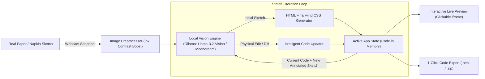

# 📸 Napkin2Code: Physical Sketch to Live Software
### *Best Open-Source AI Project — Hacktoberfest Hack Day*

> **Tagline:** Turn rough hand-drawn paper sketches into working, interactive web applications in seconds using 100% local, open-weight vision AI. Zero cloud APIs, zero cost, 100% private.

---

## 🌟 1. Executive Summary & Pitch

### The Core Problem
Commercial AI code generators (like Vercel v0, Bolt, or tldraw Make Real) are:
1. **Expensive and Closed-Source**: Rely on costly proprietary cloud APIs (OpenAI GPT-4o, Anthropic Claude 3.5 Sonnet).
2. **Cloud-Dependent**: If the venue Wi-Fi drops, they stop working completely.
3. **Screen-Bound**: They require digital drawing tablets or uploading PNG screenshots.

### Our Solution: Napkin2Code
**Napkin2Code** bridges the **physical world and digital software**:
- **Physical First**: Grab any real pen and paper, a cafe napkin, or a whiteboard in the room. Draw a rough UI layout.
- **Webcam Capture**: Hold the paper up to your laptop webcam.
- **Local Open-Weight AI**: A local Small Vision Model (**Llama 3.2 Vision** or **Moondream 2** via **Ollama**) parses the ink strokes and generates responsive HTML with Tailwind CSS.
- **Interactive Live App**: A working, clickable application renders in real-time right beside your camera feed.

### 🚀 The "Secret Weapon" Feature: Physical Iterative Editing
Unlike one-shot generators, **you can iterate with a physical pen**:
1. Draw a basic UI $\rightarrow$ Hold to webcam $\rightarrow$ Live app appears.
2. Grab your red pen, draw an arrow pointing to a button, and write: `"+ Add Dark Mode toggle and star ratings ⭐"` or cross an element out.
3. Hold it back up to the webcam and click **"Iterate"**.
4. The local AI reads the **current code** + **your handwritten physical annotations** and updates the live website in real time!

---

## 🏗️ 2. System Architecture



### Technology Stack
- **AI Brain**: Open-weight Small Vision Language Model:
  - **Moondream 2 (1.86B)** (Ultra-fast, runs on any laptop CPU/GPU) OR
  - **Llama 3.2 Vision (11B)** (Deep reasoning and layout comprehension)
- **Local Inference Engine**: **[Ollama](https://docs.ollama.com/)** (runs on `localhost:11434`, zero external network calls).
- **Frontend / Dashboard**: **Streamlit** (Split screen: Left = Live camera snapshot; Right = Interactive iframe).
- **Output Standards**: Clean HTML5, Tailwind CSS (via CDN), lightweight Vanilla JS for interactive elements (counters, modals, toggles).

---

## 👥 3. Team Division of Labor (3 Members)

### 🧑‍💻 Person 1: AI Vision Engine & Prompt Pipeline
* **Ownership**: `engine/vision_ai.py`, `engine/prompts.py`
* **Tasks**:
  1. Set up Ollama connection and verify the vision model (`ollama run moondream` or `ollama run llama3.2-vision:11b`).
  2. Write the **Initial Generation Prompt** (instructing the model to output clean, raw HTML/Tailwind without markdown fluff).
  3. Write the **Iterative Edit Prompt** (taking `[current_html_code]` + `[new_image_with_scribbles]` and outputting the updated merged code).
  4. Write a fallback parser that extracts valid HTML code blocks even if the model outputs conversational text.

### 🧑‍💻 Person 2: Image Capture, Preprocessing & Fallbacks
* **Ownership**: `core/camera.py`, `core/image_processing.py`
* **Tasks**:
  1. Implement image capture from webcam feed (via Streamlit `st.camera_input`).
  2. Implement an image enhancement pipeline: adjust contrast and sharpness so ballpoint pen/marker strokes on white paper are crystal clear for the vision model.
  3. Add a **Digital Canvas / File Upload Fallback**: Allow users to also drag-and-drop an image or sketch directly on screen if lighting is poor.
  4. Encode images to base64 for seamless transmission to the Ollama API.

### 🧑‍💻 Person 3: UI Dashboard, Live Preview & Submission Pitch
* **Ownership**: `app.py`, `README.md`, `LICENSE`, Pitch & Demo
* **Tasks**:
  1. Build the split-screen Streamlit UI:
     - Left Column: Webcam capture button, preview of captured sketch, "Initial Build" vs "Apply Physical Edit" buttons.
     - Right Column: Live interactive `iframe` rendering the generated site, code viewer tab, and "Export HTML" button.
  2. Initialize public GitHub repo with an **MIT License**.
  3. Write a high-impact `README.md` with:
     - Problem statement & Demo GIF/screenshots.
     - Open-weight model citations and license links.
     - Quickstart setup instructions.
  4. Deliver the **2-minute pitch to judges**.

---

## ⏱️ 4. Hack Day Timeline

| Time Window | Goal |
| :--- | :--- |
| **Hour 1** | Team alignment, install Ollama on all laptops, pull `moondream` model, verify webcam access. |
| **Hour 2–3** | **Person 1** gets prompt-to-HTML working with test photos; **Person 2** builds image preprocessor; **Person 3** scaffolds Streamlit UI. |
| **Hour 4** | Connect all 3 parts into the end-to-end loop: Snapshot $\rightarrow$ AI $\rightarrow$ Live Iframe. |
| **Hour 5** | Implement the **Iterative Edit Mode** (re-uploading paper with pen markings to update the app). |
| **Hour 6** | Polish UI styling, add sample demo napkins/paper sketches, write README and test offline mode (disconnect Wi-Fi to prove it works!). |
| **Hour 7** | Rehearse the 2-minute live demo pitch. Submit to OrganizerHQ before the deadline. |

---

## 🎤 5. The Winning 2-Minute Demo Script for Judges

1. **The Hook (15 seconds)**:  
   *"Judges, tools like Vercel v0 and OpenAI charge \$20/month and require constant internet connection to turn digital mockups into code. We asked: Why can't a developer or student sketch on a real coffee napkin with zero Wi-Fi and watch it turn into real software on their laptop for free?"*
2. **The First Live Action (30 seconds)**:  
   *(Hold up a piece of paper with a hand-drawn product card: title, image placeholder, and 'Buy Now' button)*  
   *"Watch this: We hold this rough sketch to our laptop webcam. Click 'Generate'."*  
   *(In 3 seconds, the live interactive website pops up on screen)*
3. **The 'Mind-Blowing' Iteration Moment (45 seconds)**:  
   *(Pick up a red marker pen live in front of the judges)*  
   *"Now, what if the client wants changes? Normally you have to retype code or prompt a chatbot. Instead, watch me draw a physical arrow pointing to the button and write: '+ Add Dark Mode toggle and 5-Star Ratings'."*  
   *(Hold paper back up to webcam $\rightarrow$ Click 'Iterate')*  
   *(The live app refreshes with a working dark mode toggle and star rating system!)*
4. **The Open-Source Impact (30 seconds)**:  
   *"This runs on 100% open-weight AI (Moondream 2 / Llama 3.2 Vision) using Ollama on our local machine. It uses zero cloud APIs, costs \$0, preserves 100% privacy, and works completely offline. The code is public under the MIT license."*

---

## 📋 6. Challenge Compliance Checklist

- [x] **Open-Source or Open-Weight AI**: Uses `Moondream 2` (Apache 2.0) or `Llama-3.2-Vision` (Llama Community License).
- [x] **Small Language Model**: Moondream is 1.86B parameters ($\le$10B criteria).
- [x] **Public GitHub Repository**: Configured with standard **MIT License**.
- [x] **README Requirements**: Documents what was built, how to run it, and links to the model cards and licenses.
- [x] **Verified Offline**: Runs locally via Ollama with zero paid proprietary APIs.

---

## 💻 7. Quickstart Commands for the Team

```bash
# 1. Install & start Ollama
brew install ollama
ollama serve

# 2. Pull the vision model (choose one):
ollama pull moondream          # Fast & lightweight (1.8GB)
# OR:
ollama pull llama3.2-vision:11b # Higher reasoning

# 3. Clone repo & install Python dependencies
git clone <your-repo-url>
cd HackToberFest
pip install streamlit ollama pillow requests

# 4. Run the application
streamlit run app.py
```
