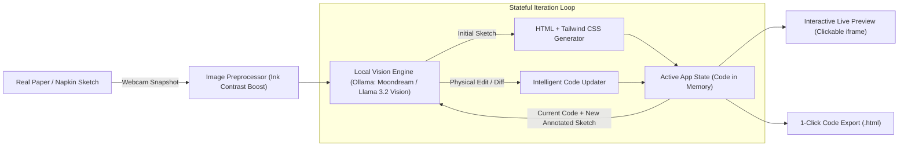

# 📸 Napkin2Code: Physical Sketch to Live Software
### *Best Open-Source AI Project — Hacktoberfest Hack Day*

[](LICENSE)
[](https://www.python.org/)
[-emerald.svg)](https://ollama.com/)
[-purple.svg)](https://github.com/vikhyat/moondream)
[](#)

> **Tagline:** Turn rough hand-drawn paper sketches and cafe napkins into working, interactive web applications in seconds using 100% local, open-weight vision AI. Zero cloud APIs, zero cost, 100% private.

---

## 🌟 1. Overview & Core Innovation

Commercial AI code generators (like Vercel v0, Bolt, or tldraw Make Real) are:
1. **Expensive and Closed-Source**: Rely on costly proprietary cloud APIs (OpenAI GPT-4o, Anthropic Claude 3.5 Sonnet).
2. **Cloud-Dependent**: If the venue Wi-Fi drops, they stop working completely.
3. **Screen-Bound**: They require digital drawing tablets or uploading PNG screenshots.

### Our Solution: Napkin2Code
**Napkin2Code** bridges the **physical world and digital software**:
- **Physical First**: Grab any real pen and paper, a cafe napkin, or a whiteboard in the room. Draw a rough UI layout.
- **Webcam Capture**: Hold the paper up to your laptop webcam.
- **Local Open-Weight AI**: A local Small Vision Model (**Moondream 2** [1.86B] or **Llama 3.2 Vision** [11B] via **Ollama**) parses the ink strokes and generates responsive HTML with Tailwind CSS.
- **Interactive Live App**: A working, clickable application renders in real-time right beside your camera feed.

### 🚀 The "Secret Weapon" Feature: Physical Iterative Editing
Unlike one-shot generators, **you can iterate with a real pen**:
1. Draw a basic UI $\rightarrow$ Hold to webcam $\rightarrow$ Live app appears.
2. Grab your red pen, draw an arrow pointing to a button, and write: `"+ Add Dark Mode toggle and star ratings ⭐"` or cross an element out.
3. Hold it back up to the webcam and click **"Apply Physical Handwritten Edits"**.
4. The local AI reads the **current code** + **your handwritten physical annotations** and updates the live website in real time!

---

## 🏗️ 2. System Architecture



---

## 👥 3. Project Structure

```text
HackToberFest/
├── app.py                      # Flagship Streamlit split-screen UI & state manager
├── requirements.txt            # Python dependencies (Streamlit, Ollama, Pillow, NumPy)
├── LICENSE                     # Standard MIT License
├── PROJECT_PLAN.md             # Hack Day division of labor & timeline
├── core/
│   ├── __init__.py
│   └── image_processing.py     # Shadow/lighting normalization, ink enhancement & image encoding
├── engine/
│   ├── __init__.py
│   ├── prompts.py              # Vision model prompt templates (Initial & Iterative)
│   └── vision_ai.py            # Ollama client, model validation & fallback engine
├── assets/
│   ├── generate_samples.py     # Script to generate sample paper sketches
│   └── samples/
│       ├── sample_product_card.png          # Base eCommerce sketch
│       └── sample_product_card_iterated.png # Revised sketch with red pen scribbles
└── tests/
    ├── test_image_processing.py # Unittest suite for image pipeline
    └── test_vision_ai.py        # Unittest suite for HTML sanitizer & prompts
```

---

## ⚡ 4. Quickstart Guide

### 1. Prerequisites
- Python 3.10+
- [Ollama](https://ollama.com/) (Free, open-source local inference engine)

### 2. Install & Start Ollama
```bash
# On macOS:
brew install ollama

# Start the Ollama server:
ollama serve
```

### 3. Pull the Small Vision Model
```bash
# Ultra-fast, lightweight (1.8GB, runs smoothly on CPU/GPU):
ollama pull moondream

# Or for deep reasoning:
ollama pull llama3.2-vision:11b
```

### 4. Clone & Run Napkin2Code
```bash
git clone https://github.com/aditya-renake/NAPKINHACKTOBERFEST.git
cd NAPKINHACKTOBERFEST

# Create virtual environment & install dependencies
python3 -m venv venv
source venv/bin/activate
pip install -r requirements.txt

# Run the app
streamlit run app.py
```

Open your browser at `http://localhost:8501`.

---

## 🧪 5. Testing & Verification

Run the test suite:
```bash
python -m unittest discover tests
```

---

## 🧠 6. Open-Weight Model Citations & Compliance

Napkin2Code is strictly compliant with open-source and hackathon guidelines:
- **Moondream 2**: Developed by Vikhyat. 1.86B parameters. Released under the permissive **Apache 2.0 License**. [Model Card](https://github.com/vikhyat/moondream)
- **Llama 3.2 Vision**: Developed by Meta AI. Released under the **Llama 3.2 Community License**. [Model Details](https://ai.meta.com/llama/)
- **Ollama Engine**: 100% open-source local LLM runner released under the **MIT License**. [Ollama GitHub](https://github.com/ollama/ollama)
- **Zero Proprietary Cloud APIs**: No OpenAI, Anthropic, or proprietary cloud endpoints are required or used.

---

## 🎤 7. The 2-Minute Demo Script for Judges

1. **The Hook (15 seconds)**:  
   *"Judges, tools like Vercel v0 and OpenAI charge $20/month and require constant internet connection to turn digital mockups into code. We asked: Why can't a developer or student sketch on a real coffee napkin with zero Wi-Fi and watch it turn into real software on their laptop for free?"*

2. **The First Live Action (30 seconds)**:  
   *(Hold up a piece of paper with a hand-drawn product card: title, image placeholder, and 'Buy Now' button)*  
   *"Watch this: We hold this rough sketch to our laptop webcam. Click 'Compile Sketch'."*  
   *(In seconds, the live interactive website pops up on screen with working buttons, counters, and Tailwind CSS)*

3. **The 'Mind-Blowing' Iteration Moment (45 seconds)**:  
   *(Pick up a red marker pen live in front of the judges)*  
   *"Now, what if the client wants changes? Instead of retyping code, watch me draw a physical arrow pointing to the button and write: '+ Add Dark Mode toggle and 20% OFF Sale badge'."*  
   *(Hold paper back up to webcam $\rightarrow$ Click 'Merge Physical Handwritten Edits')*  
   *(The live app refreshes with a working dark mode toggle and sale badge!)*

4. **The Open-Source Impact (30 seconds)**:  
   *"This runs on 100% open-weight AI (Moondream 2 / Llama 3.2 Vision) using Ollama on our local machine. It uses zero cloud APIs, costs $0, preserves 100% privacy, and works completely offline. The code is public under the MIT license."*

---

## 📜 8. License

This project is licensed under the [MIT License](LICENSE).