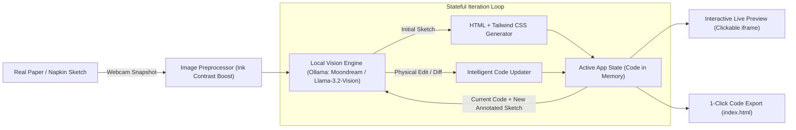

# 📸 Napkin2Code: Physical Sketch to Live Software
> **Submitted for the Hacktoberfest Hack Day Challenge: *Best Open-Source AI Project***

[](https://opensource.org/licenses/MIT)
[](https://ollama.com/library/moondream)
[](https://hacktoberfest.com/)
[](https://agentskills.io/specification)

Turn rough hand-drawn paper sketches, cafe napkins, and whiteboard wireframes into working, interactive web applications in seconds using **100% local, open-weight vision AI**. Zero cloud APIs, zero subscription fees, and 100% offline privacy.

---

## 💡 The Core Problem & Our Breakthrough

Commercial AI code generators (like Vercel v0, Bolt, or tldraw Make Real) are:
1. **Closed-Source & Expensive**: Depend on costly proprietary cloud APIs (OpenAI GPT-4o, Anthropic Claude 3.5 Sonnet).
2. **Cloud-Dependent**: If the venue Wi-Fi drops, they stop working completely.
3. **Screen-Bound**: They require digital drawing tablets or uploading PNG files.

### The Napkin2Code Solution
**Napkin2Code** bridges the **physical world and digital software**:
- **Physical First**: Grab any real pen and paper on your desk, draw a UI layout, and hold it up to your laptop's **webcam**.
- **Local Open-Weight AI**: A local Small Vision Model (**Moondream 2 (1.86B)** or **Llama 3.2 Vision (11B)** via **Ollama**) reads the ink strokes and generates responsive HTML with Tailwind CSS.
- **Physical Red-Pen Iteration**: Draw an arrow with a red pen on the paper (`"+ Add Dark Mode toggle and Star Ratings"`), hold it back up to the webcam, and click **"Apply Red-Pen Edit"**. The AI merges the changes into your active code in real time!

---

## 🏗️ Architecture



---

## 🧠 Open-Weight Models & Licenses

In accordance with Hacktoberfest challenge rules, all inference is powered by open-weight models running locally via [Ollama](https://docs.ollama.com/):

| Model Name | Parameter Size | Classification | Terms & License |
| :--- | :--- | :--- | :--- |
| **[Moondream 2](https://ollama.com/library/moondream)** | **1.86B parameters** | **Small Language Model ($\le$10B)** | [Apache 2.0 License](https://huggingface.co/vikhyatk/moondream2) |
| **[Llama 3.2 Vision](https://ollama.com/library/llama3.2-vision)** | **11B parameters** | Large Language Model ($>$10B) | [Llama 3.2 Community License](https://github.com/meta-llama/llama-models/blob/main/models/llama3_2/LICENSE) |
| **[LLaVA](https://ollama.com/library/llava)** | **7B parameters** | **Small Language Model ($\le$10B)** | [Apache 2.0 License](https://github.com/haotian-liu/LLaVA/blob/main/LICENSE) |

*Zero proprietary or closed-source cloud APIs (no OpenAI, no Anthropic, no Google Cloud keys) are used.*

---

## 📦 Agent Skills Open Standard Compliance

Napkin2Code is also packaged as an open-source agent skill adhering strictly to the **[Agent Skills Open Standard](https://agentskills.io/specification)**:
- Specification file: [`skills/napkin2code/SKILL.md`](skills/napkin2code/SKILL.md)
- Any compatible open-source AI harness can discover and load `napkin2code` as a reusable multimodal skill.

---

## 🚀 Quickstart Guide

### Prerequisites
1. **Python 3.10+**
2. **[Ollama](https://docs.ollama.com/)** installed on your machine.

### Step 1: Install & Start Ollama
```bash
# macOS (via Homebrew)
brew install ollama
ollama serve

# In a separate terminal, pull the lightweight open-weight vision model (1.8GB):
ollama pull moondream
```

### Step 2: Clone & Set Up Napkin2Code
```bash
git clone https://github.com/<your-username>/Napkin2Code.git
cd Napkin2Code

# Create virtual environment
python3 -m venv venv
source venv/bin/activate

# Install dependencies
pip install -r requirements.txt
```

### Step 3: Launch the Application
```bash
streamlit run app.py
```
Open your browser at `http://localhost:8501`.

---

## 🎬 How to Run the 2-Minute Demo for Judges

1. **Snap or Load Sketch**:
   - Hold a hand-drawn sketch up to your webcam, or click **"📄 Sample Napkin"** in the sidebar.
2. **Generate Live App**:
   - Click **"🚀 Generate Live App"**. Within seconds, a fully interactive, styled web app renders in the right panel.
3. **Physical Red-Pen Iteration**:
   - Draw an arrow on the paper with a pen (or click **"🖊️ Red-Pen Edit"** in the sidebar).
   - Click **"🖊️ Apply Red-Pen Edit"**.
   - Watch the live preview update with the dark mode switch, flash sale badge, and star ratings!
4. **Export**:
   - Click **"⬇️ Download index.html"** to export a clean, standalone website.

---

## 👥 Team & Roles

| Member | Focus Area | Core Contributions |
| :--- | :--- | :--- |
| **Member 1** | **AI Vision Engine** | Ollama integration, multimodal prompt engineering, code extraction & error recovery. |
| **Member 2** | **Image Preprocessor** | Webcam integration, contrast & sharpness enhancement algorithms, synthetic demo generators. |
| **Member 3** | **UI/UX & Documentation** | Split-screen Streamlit dashboard, iframe live rendering, Agent Skills spec, README. |

---

## 📄 License

This project is licensed under the **[MIT License](LICENSE)** — free and open for the open-source community.